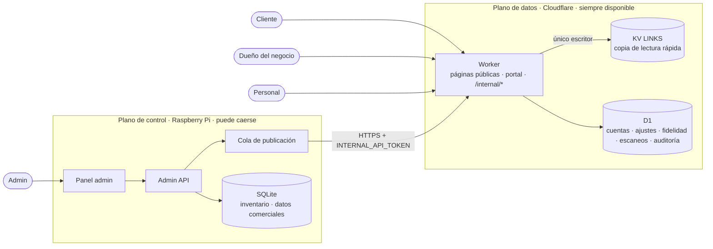

# Cuentas de negocio, prueba de presencia y nueva división de responsabilidades — diseño

> Estado: **diseño aprobado** (2026-10-24). Sustituye dos decisiones de [LOYALTY.md](LOYALTY.md):
> ahora **sí hay login para negocios**, y la fidelidad **acepta QR**, pero solo el QR rotativo
> (sección 6). Seguridad: [SECURITY.md](SECURITY.md).

## 1. Objetivo

- Cada negocio tiene **su cuenta** y configura su sistema **dentro de límites** que fijas tú.
- Los clientes registran su **visita diaria** con una **prueba de que están en el local**.
- El negocio puede mostrar un **QR que cambia solo**. Más adelante, chips que generan una URL
  distinta en cada toque.
- Todo lo que usa el negocio o el cliente funciona **aunque la Pi esté apagada**.

## 2. Decisiones

| Tema                  | Decisión                                                                                          |
| --------------------- | ------------------------------------------------------------------------------------------------- |
| Planos                | **Plano de datos** = Worker + D1 (siempre disponible). **Plano de control** = Pi (tu panel)       |
| Dueño de cada dato    | Lo que el negocio puede tocar → **D1** (Worker). Inventario y datos comerciales → **SQLite** (Pi) |
| Quién escribe en KV   | **Solo el Worker** (mediante su binding). La Pi deja de tener token de Cloudflare                 |
| Login del dueño       | **Enlace mágico por correo**. Las cuentas las creas tú (no hay registro público)                  |
| Personal              | Sin cuenta: **vinculación por dispositivo** emitida por el dueño, revocable                       |
| Prueba de presencia   | **Módulo con métodos intercambiables**: NFC estático (actual), QR rotativo, NTAG 424 DNA (SUN)…   |
| Fidelidad             | Exige un método **fuerte**: QR rotativo ahora; NTAG 424 DNA cuando haya chips                     |
| Asignar/liberar chips | **Solo el admin** (sección 5)                                                                     |

## 3. Plano de control y plano de datos



**Por qué el Worker es el único escritor de KV:** el registro de un chip combina datos de los dos
planos (asignación y tipo, de la Pi; destino, del negocio). Con dos escritores, "Re-sincronizar
todo" desde la Pi podría pisar el cambio que un negocio acaba de hacer. Con un solo escritor:

1. La Pi envía al Worker los cambios de inventario y comerciales (`PUT /internal/...`). Si falla,
   quedan en su cola y se reintentan.
2. El Worker guarda la copia en D1, **recalcula** el registro del chip y lo escribe en KV.
3. "Re-sincronizar todo" pasa a ser: la Pi envía una foto completa de su inventario y el Worker
   reconstruye KV.

**Por qué se mantiene KV si D1 ya tiene todo:** KV está replicado en todos los centros de datos y
se lee en pocos milisegundos; D1 vive en una región. La redirección lee KV; D1 queda para
escrituras y consultas.

| Dato                                              | Dueño       | Escribe                           |
| ------------------------------------------------- | ----------- | --------------------------------- |
| Negocio: nombre, plan, estado, contacto, notas    | SQLite (Pi) | Admin                             |
| Chip: número, asignación, tipo, bloqueo, activo   | SQLite (Pi) | Admin                             |
| Chip: destino, etiqueta                           | D1          | Dueño o admin (vía API interna)   |
| Negocio: visitas del premio, métodos de presencia | D1          | Dueño (dentro de límites) o admin |
| Cuentas, sesiones, personal, auditoría            | D1          | Worker                            |
| Fidelidad, escaneos, incidentes                   | D1          | Worker                            |

## 4. Identidad y acceso

### Roles

| Acción                                       | Admin | Dueño | Personal |
| -------------------------------------------- | :---: | :---: | :------: |
| Crear negocios y cuentas                     |  ✅   |       |          |
| Asignar / liberar / bloquear / borrar chips  |  ✅   |       |          |
| Cambiar plan o estado del negocio            |  ✅   |       |          |
| Cambiar destino y etiqueta de **sus** chips  |  ✅   |  ✅   |          |
| Visitas del premio (3–20)                    |  ✅   |  ✅   |          |
| Ver estadísticas                             |  ✅   |  ✅   |          |
| Ver y exportar contactos de fidelidad        |  ✅   |  ✅   |          |
| Vincular / revocar dispositivos del personal |  ✅   |  ✅   |          |
| Mostrar el QR rotativo                       |       |  ✅   |    ✅    |
| Validar canjes                               |       |  ✅   |    ✅    |
| Ver la auditoría del negocio                 |  ✅   |  ✅   |          |

### Dueño: enlace mágico

1. Tú creas la cuenta (correo + negocio) desde el panel admin.
2. El dueño escribe su correo en el portal → recibe un enlace de un solo uso que caduca en 15 min.
3. Al abrirlo se crea una **sesión**: cookie `HttpOnly`, `Secure`, `SameSite=Lax`, de 30 días,
   revocable. En D1 solo se guarda el hash.

### Personal: vinculación por dispositivo

1. El dueño pulsa **"Vincular dispositivo"** y le pone un nombre ("Caja – María").
2. Se muestra un QR o enlace de un solo uso (15 min). El personal lo abre en su móvil.
3. Ese móvil recibe una cookie de dispositivo. Cada validación de canje registra **qué
   dispositivo** la hizo. El dueño puede revocar cada dispositivo por separado.
4. El enlace de estadísticas `/r/<token>` **deja de servir para validar**: queda solo para ver
   cifras y compartirlas.

## 5. Qué puede configurar el negocio, y por qué asignar chips es solo del admin

**Sí puede:** el destino de sus chips (solo `https`), las etiquetas, las visitas del premio (3–20),
los métodos de presencia permitidos por su plan y su personal. Cada cambio queda en la
**auditoría** (quién, qué, antes, después, cuándo).

**No puede asignar ni liberar chips.** Motivos:

1. **El chip es tu inventario físico.** Asignar un chip es una operación comercial (lo vendes o
   alquilas, y el plan define cuántos tiene). Si el negocio la hiciera, el sistema dejaría de
   reflejar lo que cobras.
2. **Aislamiento entre negocios** (_multi-tenancy_). Para asignar hay que elegir de un inventario
   **global**. Exponerlo permitiría ver o tomar chips de otros. La regla de oro: un negocio solo
   ve y toca lo que ya es suyo.
3. **Liberar rompe un stand en uso.** Un chip liberado muestra "Enlace no disponible" a todos sus
   clientes. Es exactamente el incidente del 2026-10-21, pero provocado con un clic.
4. **Las estadísticas se reinician** al reasignar (`assignedAt`). Un error borraría el historial
   visible del negocio.
5. **Daño acotado** (_blast radius_). Si roban la cuenta de un negocio, lo peor que pueden hacer
   es cambiar destinos, y eso queda en la auditoría y se revierte. No pueden desmontar el
   inventario.

## 6. Prueba de presencia

### Módulo con métodos intercambiables (patrón _Strategy_)

Cada método implementa la misma interfaz. El chip o el negocio indica cuál usa, y el resto del
código (sellos, asistencia) no sabe cuál fue.

```ts
export type PresenceMethod = 'static_nfc' | 'nfc_counter' | 'rotating_qr' | 'ntag_sun';

export type PresenceResult =
  | { proven: true; method: PresenceMethod; strength: 'weak' | 'strong' }
  | { proven: false; reason: 'missing' | 'expired' | 'invalid' | 'replayed' };

export interface PresenceVerifier {
  readonly method: PresenceMethod;
  verify(request: Request, context: PresenceContext, now: number): Promise<PresenceResult>;
}
```

| Método        | Cómo prueba presencia                                      | Fuerza   | Estado              |
| ------------- | ---------------------------------------------------------- | -------- | ------------------- |
| `static_nfc`  | URL fija del chip (la actual); se puede copiar             | Débil    | Existe, se conserva |
| `nfc_counter` | NTAG 21x con contador de lecturas en la URL; falsificable  | Débil    | Opcional, futuro    |
| `rotating_qr` | QR firmado que cambia cada 60 s en la pantalla del local   | Fuerte\* | Fase 5              |
| `ntag_sun`    | NTAG 424 DNA: URL cifrada y firmada distinta en cada toque | Fuerte   | Fase 6              |

\* Una foto del QR sirve unos 2 minutos (riesgo aceptado, ver SECURITY.md §8).

La fidelidad exige `strength: 'strong'`. Las redirecciones y los usos futuros más simples pueden
usar cualquier método.

### QR rotativo

- URL: `go.penginexr.com/c/<businessId>.<ventana>.<firma>`.
  - `ventana = floor(ahora / 60 s)`.
  - `firma = HMAC-SHA256(clave_negocio, "checkin:<businessId>:<ventana>")`, truncada a 16 bytes
    en base64url.
  - `clave_negocio = HKDF(PRESENCE_MASTER_KEY, "qr:<businessId>:v<versión>")`. No se guarda
    ninguna clave en la base. Subir la versión invalida todos los QR del negocio.
- Se aceptan la ventana actual y la anterior, para tolerar relojes desfasados.
- Se muestra en el portal ("QR del día") en el móvil o la tablet del local, y se renueva solo.
- Si el cliente aún no tiene tarjeta, la verificación emite un **pase de presencia** (cookie
  firmada de 10 minutos) para que el formulario de alta no caduque mientras lo rellena.

### NTAG 424 DNA (SUN)

- El chip añade a la URL datos cifrados (UID + contador de lecturas) y una firma AES-CMAC:
  `go.penginexr.com/s/<slug>?p=<datos>&m=<firma>`.
- El Worker descifra, verifica la firma y exige que el contador **sea mayor** que el último visto
  (tabla `chip_counters`). Una URL copiada ya no sirve.
- Las claves de cada chip se derivan de `PRESENCE_MASTER_KEY` + UID (_diversificación de
  claves_): si alguien extrae la de un chip, las demás no quedan expuestas.
- Configuración: Web NFC no puede programar la firma dinámica (SDM). Se hace con la app de NXP
  (TagXplorer / TagWriter) o, más adelante, con una herramienta propia.
- Referencia: nota de aplicación NXP AN12196.

### Gama de chips

| Chip                | Prueba de presencia              | Coste relativo | Uso recomendado               |
| ------------------- | -------------------------------- | -------------- | ----------------------------- |
| NTAG 213/215/216    | Ninguna (URL fija)               | El más bajo    | Redirecciones                 |
| NTAG 213 + contador | Débil: frena el copiar-pegar     | El más bajo    | Negocios simples, sin premios |
| NTAG 413 DNA        | Fuerte (AES, SUN), menos memoria | Medio          | Fidelidad, si la URL cabe     |
| NTAG 424 DNA        | Fuerte, más claves y memoria     | El más alto    | Fidelidad, premios de valor   |

**Decisión (2026-10-24):** se compra **NTAG 213** para empezar (fácil de conseguir). La lógica de
`ntag_sun` se desarrolla igualmente para usar **NTAG 424 DNA** más adelante.

**Por qué los chips siguen bloqueados y con URL fija** (y no protegidos con contraseña para que el
negocio los reescriba): el NTAG 213 admite una contraseña de escritura de 32 bits, pero Web NFC no
puede usarla, es débil y obligaría a cada negocio a reescribir chips. Con la URL fija, el destino
se cambia en el servidor con una sesión autenticada: el "permiso para actualizar el chip" es la
cuenta del negocio, no una contraseña grabada en el chip.

## 7. Modelo de datos (D1, nuevo)

```sql
-- Copia del plano de control (la escribe solo /internal/*)
CREATE TABLE business_profile (id TEXT PRIMARY KEY, name TEXT NOT NULL, plan TEXT NOT NULL,
  status TEXT NOT NULL, updated_at INTEGER NOT NULL);
CREATE TABLE tag_inventory (slug TEXT PRIMARY KEY, number INTEGER NOT NULL, business_id TEXT,
  type TEXT NOT NULL, presence TEXT NOT NULL DEFAULT 'static_nfc', active INTEGER NOT NULL,
  assigned_at INTEGER, locked_at INTEGER, updated_at INTEGER NOT NULL);

-- Lo que configura el negocio
CREATE TABLE business_settings (business_id TEXT PRIMARY KEY, loyalty_visits INTEGER,
  qr_key_version INTEGER NOT NULL DEFAULT 1, updated_at INTEGER NOT NULL);
CREATE TABLE tag_settings (slug TEXT PRIMARY KEY, target_url TEXT, label TEXT,
  updated_at INTEGER NOT NULL);

-- Identidad
CREATE TABLE accounts (id TEXT PRIMARY KEY, email TEXT NOT NULL UNIQUE, name TEXT,
  created_at INTEGER NOT NULL, disabled_at INTEGER);
CREATE TABLE memberships (account_id TEXT NOT NULL REFERENCES accounts(id),
  business_id TEXT NOT NULL, role TEXT NOT NULL DEFAULT 'owner',
  PRIMARY KEY (account_id, business_id));
CREATE TABLE login_tokens (token_hash TEXT PRIMARY KEY, account_id TEXT NOT NULL,
  expires_at INTEGER NOT NULL, used_at INTEGER);
CREATE TABLE sessions (id_hash TEXT PRIMARY KEY, account_id TEXT NOT NULL,
  created_at INTEGER NOT NULL, expires_at INTEGER NOT NULL, last_seen_at INTEGER,
  revoked_at INTEGER);
CREATE TABLE staff_devices (id TEXT PRIMARY KEY, business_id TEXT NOT NULL, label TEXT NOT NULL,
  token_hash TEXT NOT NULL UNIQUE, created_by TEXT NOT NULL, created_at INTEGER NOT NULL,
  last_used_at INTEGER, revoked_at INTEGER);
CREATE TABLE pairing_tokens (token_hash TEXT PRIMARY KEY, business_id TEXT NOT NULL,
  label TEXT NOT NULL, created_by TEXT NOT NULL, expires_at INTEGER NOT NULL, used_at INTEGER);

-- Auditoría y presencia
CREATE TABLE audit_log (id INTEGER PRIMARY KEY AUTOINCREMENT, business_id TEXT NOT NULL,
  actor_type TEXT NOT NULL, actor_id TEXT, action TEXT NOT NULL, target TEXT,
  before_json TEXT, after_json TEXT, ts INTEGER NOT NULL);
CREATE TABLE chip_counters (slug TEXT NOT NULL, uid TEXT NOT NULL, last_counter INTEGER NOT NULL,
  PRIMARY KEY (slug, uid));

-- Cambios en tablas existentes
ALTER TABLE loyalty_stamps ADD COLUMN presence_method TEXT;
ALTER TABLE loyalty_redemptions ADD COLUMN validated_by_device TEXT;
```

Más `rate_limit_incidents` ([SECURITY.md §4](SECURITY.md#4-rate-limiting-planeado)). El esquema
final se ajusta al implementar cada fase.

## 8. Fases

Cada fase se entrega en commits separados, con los tests pasando y sin desplegar sin tu OK.

| Fase | Contenido                                                                                                                                       | Pasos del plan |
| ---- | ----------------------------------------------------------------------------------------------------------------------------------------------- | -------------- |
| 0 ✅ | Este diseño y SECURITY.md                                                                                                                       | —              |
| 1 ✅ | Capa de servicios + DTOs en el admin. CI (checks). CD: deploy del Worker e imagen arm64 en GHCR                                                 | 1, 5           |
| 2 ✅ | Worker dueño de D1 y único escritor de KV: API interna, tablas de copia, cola de la Pi → API interna, `db.batch`, la Pi sin token de Cloudflare | 2, 3           |
| 3 ✅ | Rate limiting en modo observación + registro de incidentes + vista en el panel                                                                  | 4a             |
| 4    | Cuentas: enlace mágico, portal, permisos, auditoría, dispositivos del personal (límite 3×), fin de la validación con el enlace de estadísticas  | 4b             |
| 5    | Módulo de presencia: `static_nfc` (actual) + `rotating_qr`; la fidelidad acepta el QR rotativo                                                  | —              |
| 6    | `ntag_sun` cuando haya chips NTAG 424/413 DNA; `nfc_counter` opcional                                                                           | —              |
| 7    | Revisar incidentes y pasar el rate limiting a `enforce`                                                                                         | 4a             |

**Fase 2 — decisión (2026-10-24):** el destino y la etiqueta del chip **siguen en la Pi** hasta la
fase 4 (no hay un segundo escritor hasta que exista el portal). `/internal/*` se protege solo con
`INTERNAL_API_TOKEN`; una capa extra de Cloudflare Access con _service token_ puede añadirse después
sin cambiar el código.

## 9. Decisiones adicionales (2026-10-24)

- **Portal:** `negocios.penginexr.com`, en el mismo Worker, con cookies separadas de las del
  cliente. Se crea en Cloudflare en la fase 4, avisando antes.
- **Stand perdido o dañado:** el dueño puede marcarlo. El chip queda **pausado** (no liberado), se
  registra en la auditoría y te llega un aviso para visitar el local o reponer el stand.
- **Correo:** recibir en el dominio con Cloudflare Email Routing (gratis, reenvía a Gmail). Para
  **enviar** los enlaces mágicos hay dos caminos: Cloudflare Email Service (beta, requiere Workers
  Paid) o un proveedor externo con el dominio verificado. Se decide en la fase 4.

## 10. Ideas pendientes (chips NTAG 213)

Usos simples para otros tipos de negocio, con `static_nfc`: redirección a redes, reseñas de
Google, menú y conexión al Wi-Fi. El Wi-Fi conviene hacerlo como página propia (contraseña con
botón de copiar + QR de Wi-Fi), porque iPhone no se conecta solo con un registro Wi-Fi grabado en
el chip y así se conservan las estadísticas.
