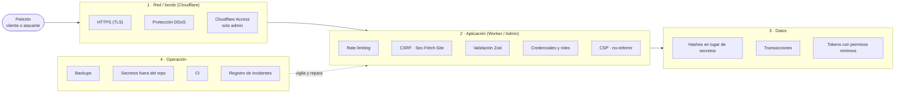

# Seguridad — modelo de amenazas y controles

> Estado: **diseño** (2026-10-24). Lo marcado como _Planeado_ se implementa en las fases de
> [BUSINESS-ACCOUNTS.md](BUSINESS-ACCOUNTS.md#8-fases).

## 1. Principio: defensa en profundidad

Cada capa asume que la anterior puede fallar. Ningún control es suficiente por sí solo.



### Clasificación de controles

| Función         | Qué hace                         | Ejemplos aquí                                               |
| --------------- | -------------------------------- | ----------------------------------------------------------- |
| Preventivo      | Impide que pase                  | Zod, CSRF, Access, rate limiting, chip bloqueado            |
| Detectivo       | Registra o avisa                 | Registro de escaneos, registro de incidentes, auditoría     |
| Correctivo      | Repara tras el problema          | Cola de publicación con reintentos, "Re-sincronizar todo"   |
| De recuperación | Vuelve a un estado bueno         | Backups diarios de SQLite, export de D1                     |
| Disuasivo       | Desanima al atacante             | Mensaje "Demasiados intentos"                               |
| Compensatorio   | Sustituye un control no aplicado | 1 sello al día (mientras no hay prueba de presencia fuerte) |

Por su naturaleza, cada control es **técnico** (código/configuración), **administrativo**
(procesos: quién tiene acceso, rotación de tokens) o **físico** (chip bloqueado, la Pi en casa).

## 2. Activos y actores

| Activo                                      | Dónde                | Por qué importa                             |
| ------------------------------------------- | -------------------- | ------------------------------------------- |
| Destino de cada chip                        | KV (copia publicada) | Si se altera, los clientes van a otro sitio |
| Nombres y teléfonos (fidelidad)             | D1                   | Datos personales (LOPDP)                    |
| Sellos y canjes                             | D1                   | Valor económico para el negocio             |
| Cuentas y sesiones de negocios _(Planeado)_ | D1                   | Dan acceso al portal                        |
| Inventario y datos comerciales              | SQLite (Pi)          | Fuente de verdad del negocio                |
| Tokens y secretos                           | Ver sección 6        | Dan acceso a todo lo anterior               |

| Actor                                 | Qué podría intentar                                          |
| ------------------------------------- | ------------------------------------------------------------ |
| Cliente tramposo                      | Sumar sellos sin ir al local, varias tarjetas, reusar canjes |
| Script / bot                          | Llenar D1 con altas falsas, adivinar códigos o tokens        |
| Persona con un enlace filtrado        | Ver estadísticas o validar canjes de un negocio              |
| Cuenta de negocio robada _(Planeado)_ | Cambiar destinos de chips de ese negocio                     |
| Escáneres de internet                 | Probar rutas (`/admin`, `/.env`…)                            |

## 3. Amenazas y controles

| Amenaza                                      | Control                                               | Estado   |
| -------------------------------------------- | ----------------------------------------------------- | -------- |
| Sello remoto copiando la URL del chip        | Prueba de presencia: QR rotativo y NTAG 424 DNA (SUN) | Planeado |
| Muchos sellos seguidos                       | 1 sello por día y tarjeta                             | Hecho    |
| Altas masivas falsas                         | Rate limiting + un teléfono = una tarjeta por negocio | Parcial  |
| Formularios enviados desde webs ajenas       | `Sec-Fetch-Site` / `Origin` (CSRF)                    | Hecho    |
| Inyección de HTML / scripts                  | Escapado en plantillas + CSP estricta                 | Hecho    |
| Fuga del token por Referer                   | `Referrer-Policy: no-referrer`                        | Hecho    |
| Validar canjes con el enlace de estadísticas | Credencial por dispositivo del personal, revocable    | Planeado |
| Acceso al panel admin                        | Cloudflare Access + validación del JWT en la app      | Hecho    |
| Robo de una copia de la base                 | Solo hashes de cookies y tokens; sin IPs              | Hecho    |
| Campos internos expuestos por la API         | DTOs explícitos (nada de `...spread` de filas)        | Planeado |
| Borrados a medias                            | Transacciones (`db.batch` en D1)                      | Planeado |
| Cambios no publicados en KV                  | Cola de publicación con reintentos                    | Planeado |
| Fichero CSV con fórmulas                     | Escapado de `= + - @`                                 | Hecho    |

## 4. Rate limiting _(Planeado)_

Mecanismo: contador por **clave** dentro de una ventana fija de 60 s (binding `ratelimits` de
Cloudflare; ventanas permitidas: 10 o 60 s). Los contadores son por centro de datos y
aproximados: sirven contra el abuso, no para contabilidad.

### Clave: el identificador más fuerte disponible

1. **Credencial del personal** → límite del personal (3×).
2. **Cookie del móvil del cliente** → límite del cliente.
3. **IP + negocio** → red de seguridad contra scripts, con límite alto.

La IP nunca es la única clave: el Wi-Fi del local, el CGNAT de las operadoras móviles y iCloud
Private Relay hacen que muchas personas compartan IP. La IP se usa solo en memoria para contar;
**no se guarda**.

### Límites

| Acción                            | Cliente                 | Personal (3×)  |
| --------------------------------- | ----------------------- | -------------- |
| Alta de tarjeta, por móvil        | 10/min                  | —              |
| Alta de tarjeta, por IP + negocio | 30/min                  | —              |
| Canjear premio, por móvil         | 10/min                  | —              |
| Validar canje                     | 30/min (sin credencial) | 90/min         |
| Tocar el chip `/:slug`            | **Sin límite**          | **Sin límite** |

Criterio: se limita lo que **escribe datos**, lo que **se puede adivinar** y lo que **es caro**.
Nunca la redirección, que es el núcleo del producto.

### Modo observación

`RATE_LIMIT_MODE = "observe" | "enforce"` en `wrangler.toml`. En `observe` se registra lo que se
habría bloqueado, pero se deja pasar. Se empieza en `observe` 2–4 semanas y se pasa a `enforce`
con datos reales.

### Registro de incidentes

Registrar cada petición bloqueada convertiría un ataque en miles de escrituras en D1 (y en un
segundo ataque contra la cuota). Se registra **como máximo una vez por minuto por origen**,
usando un limitador auxiliar con límite 1/min que decide si toca escribir.

```sql
CREATE TABLE rate_limit_incidents (
  business_id TEXT NOT NULL,
  action TEXT NOT NULL,       -- signup | redeem | validate
  actor TEXT NOT NULL,        -- customer | staff | anonymous
  mode TEXT NOT NULL,         -- observe | enforce
  minute INTEGER NOT NULL,    -- inicio del minuto (epoch ms)
  source_hash TEXT NOT NULL,  -- SHA-256(origen + sal diaria), truncado
  PRIMARY KEY (business_id, action, actor, minute, source_hash)
);
```

- `source_hash` no permite recuperar la IP y, como la sal cambia cada día, tampoco seguir a
  alguien entre días.
- Retención: 90 días.
- Se muestra por negocio en el panel admin (y, más adelante, al dueño): cuándo, qué acción, qué
  actor, cuántos minutos y cuántos orígenes distintos.
- Lectura rápida: **un origen insistiendo** suele ser un script; **muchos orígenes a una hora
  punta** suele indicar que el límite es bajo.

## 5. Identidad y credenciales _(Planeado)_

Detalle en [BUSINESS-ACCOUNTS.md](BUSINESS-ACCOUNTS.md#4-identidad-y-acceso).

| Quién            | Cómo se identifica                                            | Revocable            |
| ---------------- | ------------------------------------------------------------- | -------------------- |
| Admin            | Cloudflare Access (correo + código) → JWT validado            | Desde Access         |
| Dueño de negocio | Enlace mágico por correo → cookie de sesión                   | Sí, por sesión       |
| Personal         | Enlace de vinculación por dispositivo → cookie de dispositivo | Sí, por dispositivo  |
| Cliente final    | Cookie del navegador (hash en D1)                             | Se borra con la baja |
| Pi → Worker      | Token de servicio en cabecera (`/internal/*`)                 | Rotando el secreto   |

Reglas comunes: en la base solo se guarda el **hash** de cada token; las cookies son `HttpOnly`,
`Secure` y `SameSite=Lax`; los enlaces mágicos y de vinculación caducan en 15 minutos y son de un
solo uso; los cambios de configuración de un negocio quedan en la **auditoría**.

## 6. Inventario de secretos

| Secreto                     | Dónde vive                           | Permisos                                       | Estado             |
| --------------------------- | ------------------------------------ | ---------------------------------------------- | ------------------ |
| Token API de la Pi          | `.env` del stack en Dockge           | KV Edit + D1 (hoy); **ninguno** tras la fase 2 | Hecho → se elimina |
| `INTERNAL_API_TOKEN`        | Secreto del Worker + `.env` de la Pi | Solo `/internal/*`                             | Planeado           |
| `CLOUDFLARE_API_TOKEN` (CI) | GitHub Secrets                       | Workers Scripts, rutas de la zona, D1 Edit     | Planeado           |
| `PRESENCE_MASTER_KEY`       | Secreto del Worker                   | Firma del QR rotativo / claves de chips        | Planeado           |
| `TUNNEL_TOKEN`              | `.env` del stack en Dockge           | Solo el túnel `nfc-admin`                      | Hecho              |
| `CF_ACCESS_AUD`             | `.env` del stack en Dockge           | No es secreto (identifica la app de Access)    | Hecho              |

Nunca en el repo. Los tokens de API llevan caducidad de 1 año y se rotan con aviso.

## 7. Privacidad (LOPDP)

Ver [LOYALTY.md §6](LOYALTY.md#6-datos-personales-y-privacidad). Resumen: datos mínimos,
consentimiento separado por finalidad, baja desde la tarjeta, sin IPs ni fingerprinting, y el
enlace de estadísticas sin credencial nunca muestra nombres ni teléfonos.

## 8. Riesgos aceptados

| Riesgo                                                | Por qué se acepta                                                |
| ----------------------------------------------------- | ---------------------------------------------------------------- |
| Una foto del QR rotativo sirve ~2 minutos             | Ventana corta + 1 sello al día; para más, NTAG 424 DNA           |
| Un atacante con miles de IPs esquiva el límite por IP | El límite por móvil y "un teléfono = una tarjeta" acotan el daño |
| Cuenta de Cloudflare comprometida o caída             | Punto único aceptado; exportar D1 y KV periódicamente            |
| Chips NFC normales (estáticos) se pueden copiar       | Se mantienen para usos sin valor económico (redirecciones)       |

## 9. Lista de revisión para cada cambio

- ¿La API devuelve un DTO explícito y no filas de la base?
- ¿Las operaciones de varios pasos son una transacción?
- ¿La acción nueva escribe datos o se puede adivinar? → rate limiting.
- ¿Se guarda algún dato personal nuevo? → consentimiento y retención.
- ¿Un secreto nuevo? → añadirlo a la sección 6.
