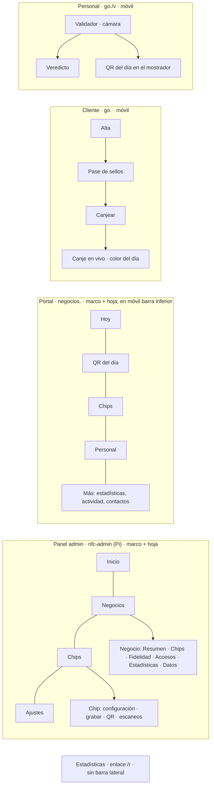

# Interfaz — diseño (v3, 2026-10-29)

> Sustituye a los dos retoques anteriores (paleta frambuesa y "barra lateral"), que conservaban la
> disposición original. Esta versión cambia **la disposición de todas las pantallas**: panel admin,
> portal de negocios, tarjeta del cliente, pantallas del personal, estadísticas y páginas de estado.

## 1. Dirección

| Tema              | Decisión                                                                                                                                                                                                                                                               |
| ----------------- | ---------------------------------------------------------------------------------------------------------------------------------------------------------------------------------------------------------------------------------------------------------------------- |
| Estilo            | **Framed sheet** (skill de diseño, `draw.mjs --app --kind smb-admin --style framed-sheet`, semilla 672812944): un marco en L tintado (barra lateral + barra superior) y el trabajo sobre una **hoja blanca** con borde de 1 px y esquinas de 16 px. Sin sombras        |
| Tipografía        | **IBM Plex Sans** (400/500/600) para todo; **IBM Plex Mono** solo para lo que se lee como etiqueta física: números de chip (`#12`), códigos de chip (`xmM6BxG`) y códigos de canje (`K7PQ-42XZ`)                                                                       |
| Color             | Un solo tono de producto, **verde azulado de tinta** `#1b6c80`: en el sello, en la serie principal de los gráficos, en el botón principal y en el subrayado de la pestaña activa. Marco tintado de ese tono (`#f1f5f6`). Estados en pares pálidos (verde, ámbar, rojo) |
| Nombre            | **PengineXR** (el remitente de los correos), con su marca: un sello circular con dos arcos de NFC                                                                                                                                                                      |
| Cara del producto | Las etiquetas físicas en mono (los chips se reconocen por su número), y el color del día como campo completo en las pantallas de canje                                                                                                                                 |

## 2. Elementos propios (solo este producto los tiene)

1. **Rack de chips** (panel admin): todo el inventario como una rejilla de chips numerados, uno por
   celda, coloreados por estado (libre, en uso, pausado, sin destino, bloqueado). Se lee el estado
   del negocio físico de un vistazo; cada celda abre su chip.
2. **Franja del día** (portal, "Hoy"): cada visita de hoy (sello o escaneo) como una marca sobre el
   eje de 6:00 a 22:00, con la hora de la última visita. Responde "¿cómo va el local hoy?".
3. **Pase de sellos** (cliente): la tarjeta como un pase con talón perforado: el talón es el premio.
4. **Color del día como campo** (canje y validador): la pantalla de canje del cliente y la del
   personal se pintan enteras del color del día, para compararlas sin leer nada.

## 3. Superficies y armazones

| Superficie         | Escritorio                                                                                                            | Móvil                                                                             |
| ------------------ | --------------------------------------------------------------------------------------------------------------------- | --------------------------------------------------------------------------------- |
| Panel admin        | Barra lateral 228 px + barra superior 48 px (buscador global de negocios y chips) en el marco; hoja blanca inset 8 px | Barra superior 48 px con menú (hoja a pantalla completa)                          |
| Portal             | Igual que el admin, con selector de negocio arriba de la barra lateral                                                | Barra superior con el negocio + **barra inferior** de 5 destinos (sin JavaScript) |
| Cliente y personal | Columna de teléfono centrada                                                                                          | Pantalla completa, acción principal **fija abajo** (zona del pulgar)              |
| Estadísticas       | Barra superior + columna centrada de 1100 px                                                                          | Una columna                                                                       |

## 4. Pantallas

### Panel admin

| Pantalla           | Pregunta                                | Disposición                                                                                                                                                                                                                                        |
| ------------------ | --------------------------------------- | -------------------------------------------------------------------------------------------------------------------------------------------------------------------------------------------------------------------------------------------------- |
| **Inicio** (nueva) | ¿Funciona todo y qué necesita atención? | Título + línea de estado ("Publicación al día · 4 negocios · 12 chips en la calle"). Franja de 4 cifras. Principal: **rack de chips**. Carril derecho: "Requiere atención" (stands pausados, chips sin destino, sin publicar) y negocios recientes |
| Negocios           | ¿Quién es cliente y en qué estado?      | Pestañas por estado con recuento, buscador, **tabla** (negocio, plan, estado, chips, fidelidad, alta). "Nuevo negocio" abre un panel lateral                                                                                                       |
| Negocio            | Todo de un cliente                      | Migas + nombre + estado; **pestañas**: Resumen, Chips, Fidelidad, Accesos (dueño y personal), Estadísticas (enlace e incidentes), Datos (formulario y borrar)                                                                                      |
| Chips              | ¿Qué hay en el inventario?              | Pestañas Todos/Libres/En uso/Pausados, buscador, "Crear chips" en la fila del título, **tabla** densa con número y código en mono                                                                                                                  |
| Chip               | Configurar, grabar e imprimir           | Migas + "Chip #12"; dos columnas: configuración y grabado NFC a la izquierda; carril con QR, URLs, escaneos y zona de peligro                                                                                                                      |
| Ajustes            | Ajustes de la plataforma                | Filas de ajustes (etiqueta y descripción a la izquierda, panel a la derecha): avisos, publicación, límites de peticiones                                                                                                                           |

### Portal de negocios

| Pantalla                         | Pregunta                   | Disposición                                                                                                                                                                          |
| -------------------------------- | -------------------------- | ------------------------------------------------------------------------------------------------------------------------------------------------------------------------------------ |
| Entrar / correo enviado / enlace | Entrar sin contraseña      | Pantalla dividida: marco con lo que hace el portal; hoja con el formulario                                                                                                           |
| **Hoy**                          | ¿Cómo va el local hoy?     | Nombre + fecha; **franja del día**; cifras de 30 días con "Premio cada N visitas · Cambiar"; acción principal "Mostrar QR del día"; carril: estado de los chips y actividad reciente |
| QR del día                       | Que el cliente selle       | Modo pantalla del mostrador: QR enorme sobre placa blanca, texto para el **cliente**; controles del dueño aparte                                                                     |
| Chips                            | Cambiar destino y etiqueta | Lista de stands con número en mono, estado y destino; cada fila se despliega para editar                                                                                             |
| Personal                         | Quién valida canjes        | Dos columnas: móviles vinculados / vincular uno nuevo                                                                                                                                |
| Actividad                        | Quién cambió qué           | Línea de tiempo agrupada por día                                                                                                                                                     |
| Estadísticas                     | Cuánto se usan los chips   | La página de estadísticas dentro del armazón del portal                                                                                                                              |

### Cliente y personal

| Pantalla                                               | Disposición                                                                                                                                                                   |
| ------------------------------------------------------ | ----------------------------------------------------------------------------------------------------------------------------------------------------------------------------- |
| Alta                                                   | Vista previa del pase vacío arriba; formulario debajo; botón al final                                                                                                         |
| **Pase de sellos**                                     | Aviso del momento arriba ("+1 sello"); el pase (cabecera con el sello del negocio, contador, rejilla, talón del premio); **barra de acción fija abajo** (Canjear / Continuar) |
| Canjear                                                | Pregunta grande y dos botones grandes abajo                                                                                                                                   |
| **Canje en vivo**                                      | Pantalla entera del color del día: negocio, reloj enorme con segundos, QR sobre placa blanca, código en mono                                                                  |
| Validador                                              | Banda superior del color del día con su nombre; visor de cámara grande; código a mano; enlace al QR del día                                                                   |
| Veredicto                                              | Campo completo verde ("Canje válido") o rojo ("Ya se usó", "No válido"); "Escanear otro" fijo abajo                                                                           |
| QR del mostrador                                       | Placa blanca con el QR, texto para el cliente, se recarga sola                                                                                                                |
| Privacidad                                             | Documento: lista de "Qué guardamos / Para qué / …"                                                                                                                            |
| Estado (baja, vincular, errores, enlace no disponible) | Una sola columna centrada con la marca, el titular y una acción                                                                                                               |

## 5. Reglas

- Nada de degradados, sombras en reposo, emojis, etiquetas en mayúsculas ni iconos en cuadros.
- Un `h1` por pantalla; títulos de 22–32 px (los de pantalla del cliente pueden llegar a 36 px).
- Cifras con `tabular-nums` y alineadas a la derecha en tablas; un cero es "0" y un dato que falta, "—".
- Objetivos táctiles ≥ 44 px en móvil; foco visible; las páginas del Worker siguen sin JavaScript
  salvo el reloj del canje, el lector QR y la consulta del estado del canje (con nonce).
- Movimiento solo como respuesta (pulsar, desplegar); el sello nuevo se "estampa".

## 6. Fases (un commit por fase)

1. Base: fuentes Plex (Worker y panel), tokens y kit de componentes del Worker.
2. Cliente y personal (Worker).
3. Portal (armazón, Hoy con franja del día, Chips, QR, Personal, Actividad, acceso).
4. Estadísticas (enlace público y portal).
5. Panel admin (armazón, Inicio con rack, Negocios, Negocio con pestañas, Chips, Chip, Ajustes).
6. Revisión con capturas a 390 y 1440 px de cada pantalla; tests, lint y despliegue.
